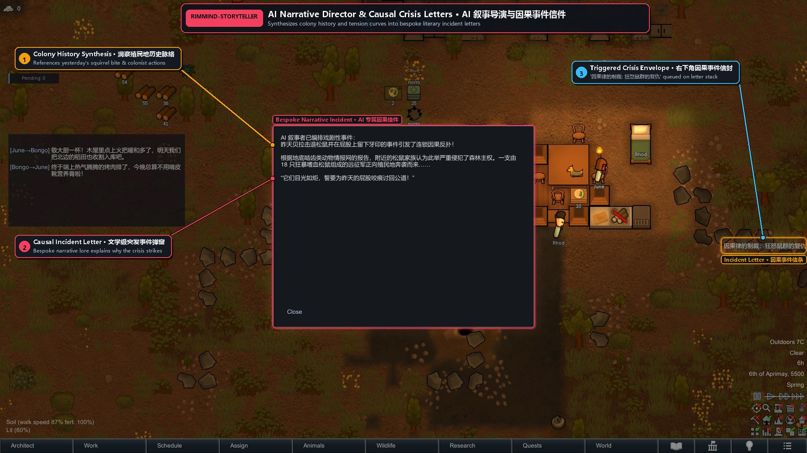
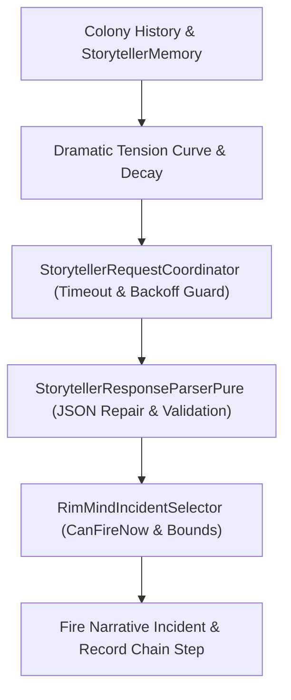

<div align="center">

# RimMind-Storyteller 📜
### AI Story Director, Dramatic Tension Tracking & Narrative Incidents for RimWorld 1.6 & 1.7

**English** | [简体中文](README_zh.md)

<p>
  <a href="https://rimworldgame.com/"></a>
  <a href="https://github.com/RimWorld-RimMind-Mod/RimWorld-RimMind-Mod-Core"></a>
  <a href="#"></a>
  <a href="LICENSE"></a>
</p>

<p><em>Experience a living RimWorld storyteller that crafts consequential, multi-chapter narrative drama based on your colony's real history.</em></p>

</div>

---

## 📖 Overview

**RimMind-Storyteller** reimagines RimWorld's classic storyteller AI. Instead of firing arbitrary raid dice based strictly on colony wealth graphs, the AI Storyteller acts as a genuine narrative director, assessing emotional pacing, past colony deeds, and unresolved conflicts to orchestrate coherent, multi-part sagas.

### Core Features
- **Dramatic Tension Curve (`StorytellerMemory`)**: Continuously monitors the colony's emotional equilibrium with daily tension decay (`TensionMath`) and player reaction tracking, balancing hardship, recovery, and sudden twists.
- **Resilient Director Pipeline (`StorytellerRequestCoordinator` & `StorytellerResponseParserPure`)**: Features non-blocking request lifecycle coordination with automatic 15,000-tick pending request timeout protection, 2,500-tick failure backoff, and brace-balanced truncated JSON repair.
- **Contextual Narrative Incident Chains**: Connects incidents logically across multi-step arcs (`chain_id`, `chain_step`, `chain_total`, `next_hint`) with bounded threat point multipliers and faction/strategy hints.
- **Altar Dialogue & Agent Console (`Window_StorytellerDialogue` & `Window_StorytellerAgentControl`)**: Communicate directly with the AI Storyteller at the Storyteller Altar or inspect and control the autonomous Storyteller Agent in real time.

---

## 🎮 In-Game Showcase


*Bespoke causal incident letter: The AI Storyteller synthesizes yesterday's squirrel bite into a dramatic crisis letter ("Wrath of Causality: Revenge of the Frenzied Squirrel Pack") and queues the red incident envelope on the right HUD.*

---

## 🏛️ Storyteller Director Architecture



---

## 🛠️ Installation & Load Order

```text
1. Harmony
2. Core (Vanilla RimWorld)
3. RimMind-Core
4. RimMind-Storyteller
```

---

## 🧪 Developer Guide & Testing

Run unit tests directly:

```powershell
dotnet test RimMind-Storyteller/Tests/RimMindStoryteller.Tests.csproj -c Release
```

---

## 📜 License

Licensed under the [MIT License](LICENSE).
