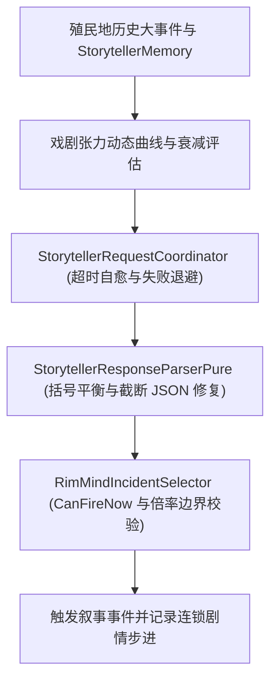

<div align="center">

# RimMind-Storyteller 📜
### 专为 RimWorld 1.6 & 1.7 打造的 AI 叙事导演、戏剧张力追踪与连锁事件系统

[English](README.md) | **简体中文**

<p>
  <a href="https://rimworldgame.com/"></a>
  <a href="https://github.com/RimWorld-RimMind-Mod/RimWorld-RimMind-Mod-Core"></a>
  <a href="#"></a>
  <a href="LICENSE"></a>
</p>

<p><em>告别冰冷机械的财富点数投骰，体验真正依据殖民地恩怨情仇推演的多章节戏剧史诗。</em></p>

</div>

---

## 📖 模块概览

**RimMind-Storyteller** 重塑了 RimWorld 的核心叙事体验。它不再单纯根据殖民地财产价值无脑刷怪，而是作为一名真正的故事导演，实时监控殖民地的情绪起伏、生死存亡与历史因果，编排环环相扣的多幕戏剧。

### 核心特性
- **戏剧张力动态曲线（`StorytellerMemory`）**：结合每日张力自然衰减（`TensionMath`）与玩家情感反应反馈，实时调节殖民地的危机承压与休整节奏。
- **高可靠请求编排与截断修复（`StorytellerRequestCoordinator` & `StorytellerResponseParserPure`）**：内置 15,000 Tick 悬空请求超时自愈与 2,500 Tick 失败退避保护，支持嵌套对象截断与未闭合字符串的智能 JSON 修复。
- **因果相承的连锁事件链**：通过 `chain_id`、`chain_step`、`chain_total` 与 `next_hint` 串联多幕剧情，并自动约束威胁点数倍率与敌对派系/袭击策略。
- **叙事祭坛对话与智能体控制台（`Window_StorytellerDialogue` & `Window_StorytellerAgentControl`）**：支持在祭坛建筑与叙事者直接对话祈愿，或通过智能体控制台实时查看与调度叙事导演状态。

---

## 🎮 实机特性展示


*定制因果剧情信件实机：AI 叙事者结合前一日小人击退松鼠的历史细节，生成充满戏剧张力的危机弹窗与信封（`因果律的制裁: 狂怒鼠群的复仇`）。*

---

## 🏛️ 叙事导演流转架构



---

## 🛠️ 安装与加载顺序

```text
1. Harmony
2. Core (RimWorld 原版)
3. RimMind-Core
4. RimMind-Storyteller
```

---

## 🧪 开发者测试指南

运行单元测试：

```powershell
dotnet test RimMind-Storyteller/Tests/RimMindStoryteller.Tests.csproj -c Release
```

---

## 📜 开源协议

本项目采用 [MIT License](LICENSE) 开源许可证。
